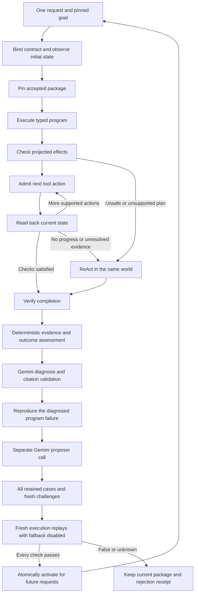

# Connected inference, judgement and repair

The controller from [document 18](18-running-repair-loop.md) pins a package, executes its typed program, continues in ReAct when necessary, and records a deterministic terminal assessment. The November 16 connection adds a separate Gemini diagnostic call, validates its schema and citations, and passes a supported program finding to a distinct Gemini proposer call. Existing program comparison, preservation checks and fresh execution gates decide acceptance. No alternate proposer is selected if Gemini fails.

This connected slice repairs one existing program function. Enable it with `--allow-kernel-repair`; without that flag, the program stays frozen. Missing recorded evidence, unsupported diagnoses, unknown citations and unavailable Gemini calls stop before proposal. Policy/schema engineering and broad ontology construction remain outside this connector. The active episode never changes package halfway through execution.

The [November 16 native proof](20-live-acceptance.md#gemini-loop-verified-november-16-2026) exercised this automatic path from the original seed: a real Qwen failure, separate Gemini diagnosis and proposal, acceptance after native execution, then three passing subsequent episodes. It demonstrated one numeric-filter correction within the existing Spotify task family.



## Run it

```sh
python3 scripts/inference.py demo --archive runs/learning/controller-example
```

This local component demonstration explicitly injects a search proposer. It collects three raw ReAct episodes, demonstrates a relationship gap with same-state recovery, repairs it, introduces a numeric-selection gap, repairs that, and executes new and old cases through the accepted package. The recovery actor is scripted. This fixture does not exercise either Gemini role and is not evidence of the agreed model improvement protocol.

For a list of independent requests:

```sh
python3 scripts/inference.py run --archive runs/learning/my-stream --requests my-requests.json
python3 scripts/inference.py learn --archive runs/learning/my-stream --allow-kernel-repair
```

`my-requests.json` is an array. Each local entry contains `request_id`, `adapter: "local"`, `actor: "ollama"`, and `data: {contract, before}`. `raw: true` starts in ReAct. Set `learn: false` to collect execution evidence. The `learn` command above invokes Gemini diagnosis and then a separate Gemini proposal for a supported, reproduced function failure. Without `--allow-kernel-repair`, learning returns `KERNEL_FROZEN`. With no recorded episode, it returns `GEMINI_DIAGNOSIS_REQUIRED`. Blocked learning exits with code 2; an evaluated proposal that makes no improvement exits with code 1. Each entry is one user request with internal tool/model steps, not a conversation.

The controller records the complete request manifest before execution. A stable `request_id` prevents duplicate execution: resubmission returns its previous receipt and can resume learning. Reusing that ID with different input is rejected. A crash after execution starts but before a final receipt produces `INTERRUPTED_REQUIRES_RECONCILIATION`; it never silently repeats possibly completed writes. Repair work itself is restartable and retains spending. One inference owner and one repair worker hold separate process locks.

The older [live model acceptance harness](20-live-acceptance.md) defines two repair cycles and includes a synthetic relationship fixture. Its original search-based results are historical evidence. The current AppWorld proof uses only the three selected native tasks and the separate Gemini roles; it does not substitute those synthetic fixtures for native performance.

The native integration fixture uses the previously selected training scenario `07b42fd`, Spotify, tasks `07b42fd_1`, `07b42fd_2`, and `07b42fd_3`:

```sh
.venv/appworld/bin/python scripts/inference.py run \
  --archive runs/learning/native-example \
  --requests examples/inference-appworld.json
```

This historical fixture selects `actor: "reference"` and is not the requested live demonstration. For current execution evidence, use a separate AppWorld manifest with `actor: "ollama"` and `learn: false`, followed by `learn --allow-kernel-repair`. Alternatively, enable learning on each request and pass `--allow-kernel-repair` to `run` for the automatic path used in the proof. Native execution requires the installed AppWorld environment and permission to start its localhost server. A failed starting episode remains failed even if its subsequent learning phase improves the program; the CLI's task-success exit code preserves that distinction.

## What “not working” means

Task outcome and execution outcome are different fields. A kernel gap can be recovered while the task succeeds. A timeout can leave the task outcome unknown. A failed ReAct attempt can still provide a reproducible program counterexample.

| Observation | Recorded outcome | Controller response |
| --- | --- | --- |
| Projected selection changes protected records | `CAPABILITY_GAP` | Refuse that plan before dispatch, hand off with evidence |
| No action remains but required updates are missing | `NO_PROGRESS` | Continue with ReAct from current state |
| Admitted action produces no observed state change | `NO_PROGRESS` | Hand off after readback; do not repeat the kernel action |
| Required properties, relationships or coverage are unresolved | `EVIDENCE_GAP`, task `UNKNOWN` | Gather evidence; unknown cannot count as success |
| ReAct repeats an identical observable outcome three times | Execution `NO_PROGRESS` | Stop that episode and assess current state |
| Mandatory final-state check fails | Task `FALSE`, reward `0` | Record the exact failed check and replayable initial case |
| All bound checks and applicable official checks pass | Task `TRUE`, reward `1` | Record success, including whether fallback was needed |
| A write may have happened but its result is uncertain | `UNKNOWN_TOOL_OUTCOME` | Stop; no blind retry or same-state fallback |
| Model/runtime/integrity failure | `RUNTIME_OR_EVIDENCE` route | Retain evidence; do not call it a learned-program defect |
| Native evaluator fails while local checks pass | `ADAPTER_OR_CONTRACT` route | No program promotion from this disagreement |
| Budget exhausted | Named budget/deadline execution stop | Assess current state; no budget reset on handoff |

The four completion obligations are complete observed scope, known target set, all targets updated, and preservation of unrelated observed state. They are independently computed from the trusted contract and before/after evidence. AppWorld's unchanged evaluator additionally checks the native task. The task's natural-language interpretation and observation coverage still belong to the trusted adapter.

Every exit attempts a current readback, including exits where the actor never says `finish`. A terminal readback does not erase a runtime stop or imply that an uncertain write was safely reconciled. Model/tool execution budgets remain unchanged during handoff. Native adapter reads and writes additionally share a server-enforced API call budget (default 512), including reads outside the model loop.

## Whole trajectory without a context dump

[judge.py](../../repair_runtime/judge.py) checks ledger integrity and every original artifact, then scans every event in segments of at most 64 events by default. Each segment has sequence bounds, event counts, chain endpoints and cited findings. The final receipt records covered events, completeness, failed checks, handoffs, execution stop, task outcome and repair route. Native MCP calls also receive paired start/result coverage across bounded artifact segments.

This is a deterministic evidence assessment, not the assigned Gemini judge. Full coverage means every recorded event was inspected for the implemented conditions, not that a language model certified every reasoning statement. Gemini is assigned the separate diagnostic stage, using cited segments and original artifact pages. Its opinion must not override the deterministic completion or regression gates.

A recovered task still enters the case archive. Repair separately runs the pinned program on its original input. If the program already passes, no patch is invented. If it fails, its failed requirements identify the bounded repair target. Types, properties, relations and case-scoped identities are indexed in the existing computational store. The candidate is a typed operator graph containing slot references, never song names, IDs, task answers or executable Python.

## Acceptance and regression

The learned surface now implements four existing locked operators: entity lookup, categorical filtering, relationship filtering and numeric filtering. Numeric clauses support `gte`, `gt`, `lte`, `lt`, and `eq`; missing or nonnumeric evidence is unresolved. The operator names and interpreter are protected. Only one named program function may change per candidate.

Every promotion requires:

1. A reproduced target failure, followed by a target fix.
2. Paired parent/candidate checks on every retained case, preserving every previously true requirement.
3. Sixteen frozen fresh structural challenges for the function and capability being repaired. Other functions remain unchanged and all observed old cases remain in regression.
4. Fresh real executions of every retained case with the candidate pinned and ReAct fallback disabled. Each replay must reproduce the original bound initial state and finish successfully. Native cases must pass the official AppWorld checks.
5. Complete receipts, unchanged protected source identities, the same active parent and the same archive generation at activation.

Unknown or missing results block activation. Higher aggregate performance cannot compensate for one broken old case. Repair budget exhaustion or an unsupported edit leaves the current package active and records the cause. This proves preservation on the retained suite and fresh challenges, not universal absence of regressions.

## Native adapter boundary

[appworld_runtime/inference.py](../../appworld_runtime/inference.py) binds the public request grammar “Follow all the {genre} artists on Spotify that have at least {n} followers.” It authenticates and observes through official MCP, paginates the artist and following collections, and binds requested follow effects to documented endpoints. The learned program selects entities from these observations. The adapter never reads reference solutions or private task data to choose them.

Follower count changes when this account follows an artist. The normalized property `baseline_adjusted_follower_count` is current count minus current own membership plus initial own membership. This preserves the initial selection condition while allowing exactly the requested membership effect. Raw current counts remain in the transcript, and unrelated count changes remain detectable. The completion scope covers observed artists and own following relationships; official checks cover the native requirements beyond that representation.

The full API catalog stays behind `discover_tools`, `inspect_tool` and `call_tool`. Native names belong inside `call_tool.arguments.name`, not at the top-level action field. The broker supplies scoped session credentials, and generation is constrained by the inspected API schemas. The model also has `inspect_state`: an empty request inspects available types and properties; a request with an entity type and caller-specified predicates queries the observed store with pagination. The reference fixture retains its separately labeled scripted helper. Live mode executes the predicates the model supplies and never invokes that helper.

## Limits

The connected Gemini cycle is limited to existing program functions and the declared selective-update surface. Broad task-conditioned ontology construction, semantic definition retrieval and validated extension are unimplemented: the current adapter binds one Spotify grammar, and the archive indexes observed types, properties and relationships. A diagnosis about actor argument formatting does not authorize a program or schema patch. Such findings remain recorded separately. Arbitrary language binding, additional applications, new operator semantics and deep multi-hop planning remain unsupported. Extending the task surface requires a versioned adapter/contract and independently checked cases.
