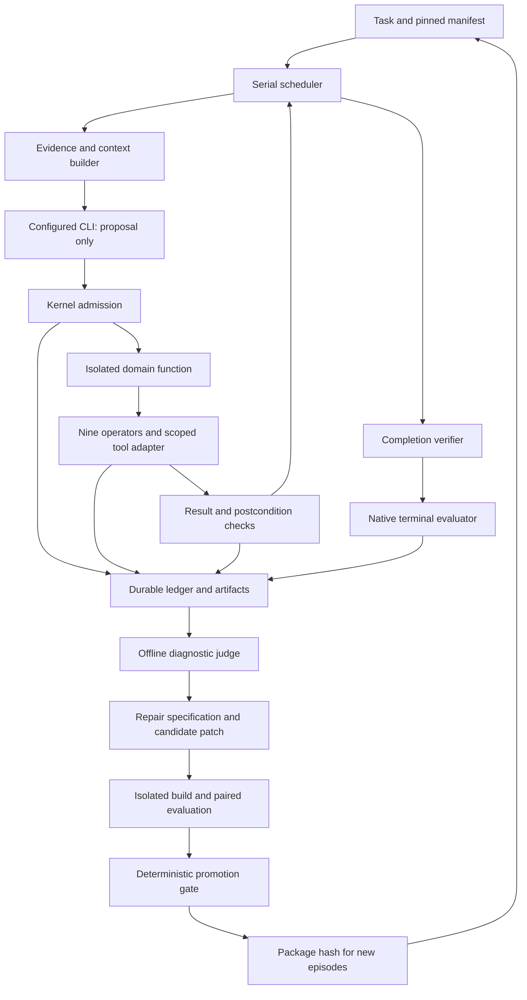

# Controlled agent system: connected implementation plan

Design version: 1.1. Date: November 13, 2026. Status: full system specified; the [first ReAct component](13-react-component.md) is implemented with its own trace version. This directory connects a single ReAct actor, a trusted execution kernel, frozen domain packages, deterministic verification, and an offline diagnostic/repair loop.

**Latest component scope:** [document 19](19-connected-inference.md) connects controlled inference, checked same-state fallback, whole-ledger judgement, automatic repair and fresh regression execution. It adds numeric selection and native qualification on the selected AppWorld training scenario. It supersedes earlier blanket deferrals of this integration. [Document 18](18-running-repair-loop.md) owns the persistent repair store and bounded program search. Arbitrary ontology construction and broader full-system acceptance remain separate work.

**Active scope correction:** start with [one narrow task family and inference](11-narrow-training-and-inference.md). That document and profile 1.1 override the earlier multi-surface rollout and broad qualification requirements. Start with raw tools; introduce one typed helper and only necessary graph operators if evidence justifies them. Long-task curricula and second surfaces are deferred.

The architecture makes execution accountable and failures diagnosable. It cannot guarantee that a model will solve every task. Success claims require the tests and benchmark evidence below.

The [computational learning protocol](12-computational-learning-protocol.md) connects observed data, task constraints, reusable relationship/constraint-handling procedures and a protected execution state machine. Its [machine-readable companion](computational-protocol.json) records ownership, lifecycle edges, guards and learning boundaries. Domain learning targets structured mappings, functions and justified schema/interface changes, not entity-specific answers or growing prompt instructions. C0 remains the implemented subset; this protocol defines subsequent integration.

**Read the contracts, then build in the gated order.**

| Document | Owns | Depends on |
| --- | --- | --- |
| [01-contracts.md](01-contracts.md) | IDs, records, interfaces, ownership, errors, version negotiation | [contracts.schema.json](contracts.schema.json), [profile.json](profile.json) |
| [02-inference-and-control.md](02-inference-and-control.md) | CLI invocation, ReAct scheduler, lifecycle, completion, bounded loops | Contracts, kernel, context |
| [03-execution-kernel.md](03-execution-kernel.md) | Authority, admission, effects, budgets, process isolation, recovery | Contracts, [durable trace contract](../../execution-trace-protocol-v1.md) |
| [04-domain-and-surfaces.md](04-domain-and-surfaces.md) | Tool onboarding, graph semantics, nine operators, package construction, benchmark adapters | Contracts and kernel |
| [05-long-tasks-and-context.md](05-long-tasks-and-context.md) | Evidence acquisition, indexing, packing, compaction, dependency invalidation | Trace contract, domain schema |
| [06-judge-and-diagnosis.md](06-judge-and-diagnosis.md) | Deterministic checks, judge rubric, long-trace inspection, evidence reads, diagnosis | Contracts, context, evaluator |
| [07-repair-and-promotion.md](07-repair-and-promotion.md) | Repair specification, code generation, isolated build, experiments, release | Judge and evaluation |
| [08-evaluation-and-success.md](08-evaluation-and-success.md) | Native metrics, policy tests, splits, comparison, promotion gate, learning exports | Every runtime component |
| [09-build-and-acceptance.md](09-build-and-acceptance.md) | Component gates, capability probes, acceptance scenarios, requirements coverage | All specifications |
| [10-worked-lifecycle.md](10-worked-lifecycle.md) | Complete example from onboarding through long inference, diagnosis and repair | All specifications |
| [11-narrow-training-and-inference.md](11-narrow-training-and-inference.md) | Active one-family curriculum, fixed-weight learning, inference and optional graph ablation | Existing contracts and active profile |
| [12-computational-learning-protocol.md](12-computational-learning-protocol.md) | Data/constraint separation, reusable computation, guarded control and learning updates | Existing contracts, component algorithms, [computational-protocol.json](computational-protocol.json) |
| [13-react-component.md](13-react-component.md) | Implemented first component, commands, output storage, compaction and limits | Existing Proposal schema; dedicated component configuration |
| [14-judge-evidence.md](14-judge-evidence.md) | Implemented trace audit, indexed evidence reads and exact inspection receipts | Component ledger and original artifacts |
| [15-appworld-surface.md](15-appworld-surface.md) | Native selective-update task selection, MCP baseline, official evaluation and same-episode handoff | Existing ReAct loop, official AppWorld MCP and training data |
| [16-completion-checks.md](16-completion-checks.md) | Executable completion contracts, before/after checks, requirement evidence and four synthetic episodes | Existing ReAct verifier, trusted request binding and scoped observations |
| [17-repair-scoring.md](17-repair-scoring.md) | Paired synthetic repair scoring, targeted fixes, per-case regressions and immutable decision receipts | Completion evidence, fixed suite and trusted helper implementations |
| [18-running-repair-loop.md](18-running-repair-loop.md) | Persistent automatic construction/repair, computational entity discovery, regression protocol, recovery and development activation | Bound completion cases, closed operator programs and existing ReAct execution |
| [19-connected-inference.md](19-connected-inference.md) | Forced inference, failure detection, same-state recovery, whole-ledger judgement and native regression-gated repair | Existing program store, completion checks, ReAct broker and native MCP adapter |
| [20-live-acceptance.md](20-live-acceptance.md) | Preregistered live-model proof, provider wire evidence, repeated native runs and regression negative control | Connected inference and configured local model |

[event-catalog.json](event-catalog.json) maps every accepted event type to its payload schema. [contract-cases.json](contract-cases.json) contains valid/invalid wire examples. [validate_spec.py](validate_spec.py) checks the document links, schema references, examples, event registry and profile consistency; it does not implement or test the runtime.

The existing [execution record specification](../../execution-trace-protocol-v1.md) remains the authoritative storage and transaction design. Its JSONL/OTel views are projections of the ledger. This bundle completes inference, domain execution, long-context, judge, and repair behavior around it.

These are logical components, not a mandate for separate services or multiple autonomous agents. V1 uses one scheduler process, isolated model/function/evaluation workers, one SQLite writer, and serial candidate evaluation. No actor delegation or self-spawning.

**Authority and interfaces.** The actor chooses among admitted possibilities and may change its plan. The kernel owns permission, lifecycle and spending. The verifier owns checked facts. The judge proposes explanations and repair targets. The repair proposer emits a patch. The promotion gate consumes measured results. No model can change another component's authoritative output.

**Specification precedence.** Explicit user instructions and the locked operator membership take precedence. Within this proposed implementation, `contracts.schema.json` owns wire shapes, `profile.json` owns numerical defaults, document 01 owns shared semantics, component documents own algorithms, and document 09 owns acceptance evidence. Conflicts fail a design check and must be corrected before implementation. Earlier `agent-protocol-v1.json` is retained as a superseded delegation sketch; its worker topology and limits do not apply to this single-actor design. Earlier training and MCP documents remain rationale and invariants where compatible.

**Closed decisions versus external capabilities.** Every external dependency has a required capability, a probe, and a defined unavailable path in document 09. Missing capability produces a named state and evidence receipt. It never silently substitutes a model, tool, evaluator or dataset. Numeric settings are initial engineering choices, pinned for comparisons, not experimentally optimal constants.

**Implementation target.** Python 3.12 with standard-library SQLite; JSON Schema Draft 2020-12 validation; immutable package/artifact hashes; Linux OCI workers for untrusted code; CLI model transport using existing user configuration. Resolve runtime dependencies and the base image to exact lockfile versions/image digests during bootstrap. Record those identities before any scored run. No live dependency installation inside episodes or candidate evaluation.

**First usable outcome.** One narrow AppWorld family runs through the broker with reconstructable traces, honest terminal statuses and official evaluator outputs. One supported failure can produce a bounded repair with visible-instance regression checks and a frozen sealed-instance comparison. If no defect is demonstrated, retain the working raw-tool baseline. Long episodes, all-nine-operator implementation and a second surface are not required for this milestone.

**Non-goals for v1.** Distributed scheduling, unrestricted generated shell, autonomous policy changes, live self-modification, model weight training, and production deployment. Their absence does not remove the required tracing, continuation, sandboxing, or measured improvement gates for the defined system.
