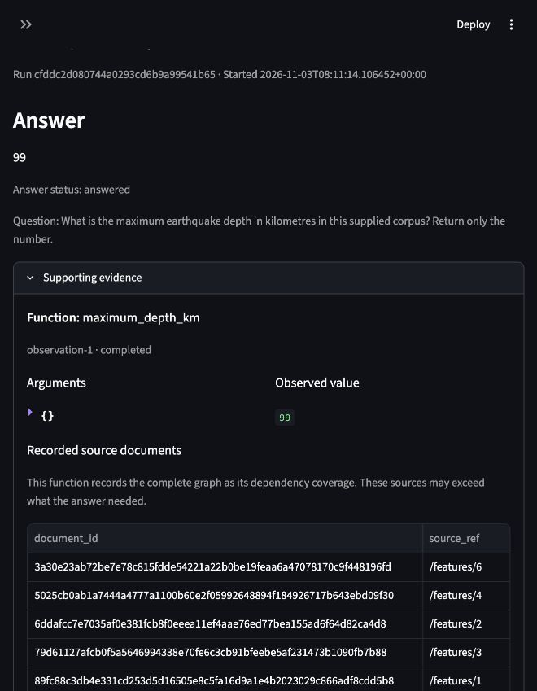

# Verified local pilot

The application is available at [127.0.0.1:8501](http://127.0.0.1:8501). Start it again with `uv run oak serve`. Gemini uses the existing GCP configuration and application-default credentials through the pinned CLI.

| Check | Actual result |
| --- | --- |
| Final component suite | 50 passed, including live USGS API checks |
| Coffee corpus extraction | 5,746 rows and 40,222 field values matched the official CSV |
| Coffee construction | 3/3 after a format repair |
| Coffee development | 3/3 on the frozen kernel |
| Coffee untouched held-out questions | 3/3 on the same frozen kernel |
| Dynamic corpus | 7 events expanded to 15; five prior trajectories replayed; fresh count 15 |
| Real model-proposed adapter | Function renamed; six prior trajectories replayed; fresh depth answer 99 km |
| Resume | Actual provider failures retained; exact completed model receipts reused |
| Browser | Submitted and resumed the same real request; answer 99 and its execution evidence visible |
| Documentation and code checks | Strict MkDocs build, Ruff, and diff checks passed |

The official Coffee metric is normalized exact match. The first construction answers included extra prose and scored 0/3 despite correct numeric tool values. The repair changed answer formatting and reused the unchanged validated graph/functions. Final evaluation questions and labels did not enter that repair. Nine selected questions are a small functional check, not a reproduction of the paper's reported aggregate results.

Known usage is approximately $2.25. About $1.66 remains reserved for interrupted or failed requests without reported usage. The shared limit is $40; these are estimates and reservations, not a verified provider invoice. The exact final ledger snapshot is in [acceptance.json](acceptance.json).

[Full acceptance evidence](acceptance.json) links source hashes, run/revision identities, benchmark reports, process tests, the original-corpus replay proof, and the actual adapter proposal. Separate reports cover [Coffee grounding](coffee-graph.json), [dynamic corpus](dynamic-corpus.json), [adapter and resume](adapter-loop.json), and [runtime components](runtime-components.json).

The application is a local single-user pilot. Logical validity, data integrity, recorded-call replay, and fresh task success remain separate evidence. Adapters support equivalent interface renames, not arbitrary semantic migrations. Hosted LangSmith tracing is optional and unverified. Paper defaults and implemented pilot limits are distinguished in [the runtime method](../runtime-method.md).
