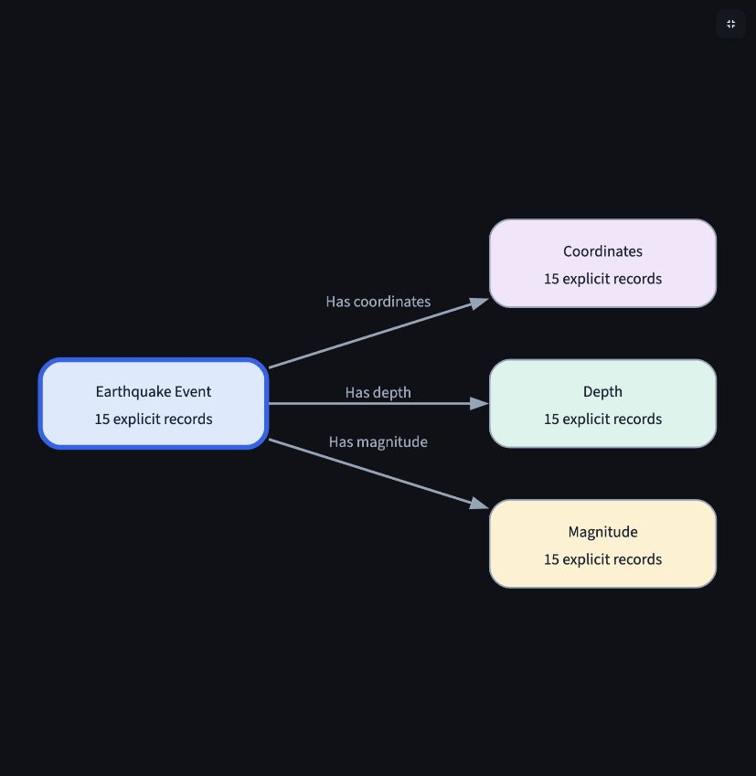
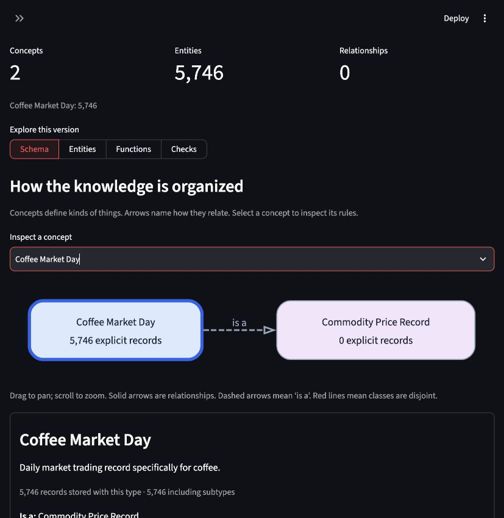

# Ontology UI verification

Verified on 2026-11-03 against genuine saved pilot artifacts. This refinement changes inspection and presentation only.

## Visible behavior

- Readable version numbers and dates replace revision hashes in the main selector.
- Schema maps show named concepts, directed and labeled relationships, separate inheritance, and disjointness.
- Concept inspectors expose datatypes, required fields, value multiplicity, identity, inherited declarations, and class restrictions.
- Entity labels come from actual names, dates, and values. Search, pagination, bounded neighborhoods, linked values, and original source evidence are available.
- Function inspectors show the actual saved operators, inputs, field reads, and returned result.
- Exact identifiers, OWL, and complete revision downloads remain available in technical details.

## Genuine data

The active USGS revision contains 15 earthquake events and their coordinates, depth, and magnitude entities: 60 entities and 45 directed links. The entity inspector displays a four-node, three-link neighborhood for the selected earthquake and explicitly identifies the displayed scope. The active Coffee revision has 5,746 daily records and no instance relationships. Its schema map shows Coffee Market Day as a Commodity Price Record. All fourteen scoped property declarations remain distinguishable, seven local and seven inherited.

## Checks actually performed

- `.venv/bin/pytest -q`: **56 passed, 2 skipped**. The skipped checks require explicit live USGS API access; this presentation change did not require another API capture.
- New helper checks use actual saved USGS/Coffee artifacts and the genuine W3C Wine fixture. They cover labels, inheritance, property scope, disjointness, relation characteristics, cardinality wording, and bounded neighborhoods.
- Three new AppTests clone the real catalog and reuse immutable pilot artifacts. They verify readable versions, source JSON, actual entity values, Coffee date search, function steps, and unchanged budget/run history.
- Browser inspection verified readable USGS arrows and Coffee inheritance, concept selection, and actual entity values/neighborhood counts. The inspectors use native selectors and expandable records; graph nodes themselves do not dispatch selection events.
- Ruff and whitespace checks passed. The strict documentation build includes the new presentation module reference.

No mock data, model calls, dependency changes, or new ontology revisions were introduced. The ledger remains at 219 calls, USD 2.251107 estimated spend, and USD 1.6573425 reserved against the user's USD 40 cap.

## Browser evidence

